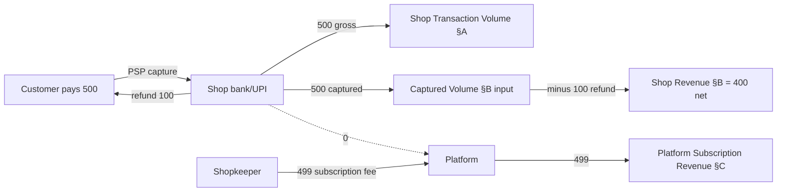

# Financial Metric Definitions

> Canonical definitions for the three financial metrics the PrintShop SaaS
> platform tracks. These definitions exist because the current source code
> **conflates** them in at least two places (see §4 — Confirmed bugs). This
> document is the source of truth; any report that does not match these
> definitions is a defect.
>
> Source files verified:
> - `prisma/schema.prisma` — `Order`, `PaymentAttempt`, `Subscription` models
> - `src/app/api/v1/shops/me/reports/daily/route.ts` — daily reconciliation
> - `src/app/api/v1/admin/analytics/route.ts` — platform analytics
> - `src/lib/repositories/order.repository.ts` — order query surfaces
> - `packages/utils/src/currency.ts` — `formatINRFromPaise`
> - `src/lib/utils/timezone.ts` — `getZonedDayBounds`

## Principles (apply to all three metrics)

1. **Integer paise only.** `Order.totalAmountPaise` is `Int` (`schema.prisma:80`). Display via `formatINRFromPaise`; never aggregate as float.
2. **Timezone is the shop's.** "Today" = `getZonedDayBounds(dateParam, shop.timezone)` (`daily/route.ts:35`). Vercel runs UTC — server-local is 5h30m off for IST.
3. **A customer-submitted UTR is never revenue.** Only `paidAt + paymentTxnId` set by an authorized webhook or shopkeeper counts (`daily/route.ts:50`).
4. **Refunds subtract from revenue.** A paid-then-refunded order is NOT revenue. Current code violates this — see §4.

## A. Shop Transaction Volume

> **Definition:** Total customer payment **intent value** for orders that
> reached a captured-or-beyond state, in a shop, in a time window.
> **Excludes** orders that were never paid (awaiting_payment, cancelled
> before payment).

### A.1 Source fields

`Order.shopId` (`schema.prisma:77`), `Order.totalAmountPaise` (`schema.prisma:80`),
`Order.status` (`schema.prisma:79`), `Order.createdAt` (`schema.prisma:89`),
`Order.paidAt` (`schema.prisma:85`).

### A.2 Calculation formula

```
shopTransactionVolumePaise(shopId, windowStart, windowEnd) =
  SUM(totalAmountPaise)
  FROM orders
  WHERE shopId = :shopId
    AND createdAt >= :windowStart AND createdAt <= :windowEnd
    AND status IN ('paid', 'printing', 'ready', 'collected', 'refunded')
    -- EXCLUDES 'awaiting_payment' and 'cancelled'
```

**Window column:** daily report (`daily/route.ts:38-41`) filters on `createdAt`
("orders placed today"). For "payments captured today" filter on `paidAt`.
This document recommends **two** distinct metrics — `placedVolume` (`createdAt`)
and `capturedVolume` (`paidAt`) — to avoid ambiguity.

### A.3 Timezone handling

Window `[windowStart, windowEnd]` MUST be shop's timezone-local midnight
converted to UTC instants via `getZonedDayBounds(dateParam, shop.timezone)`.
Do NOT use `new Date('2026-10-22T00:00:00Z')` — UTC midnight = 05:30 IST.
DB-002 fixed this for the daily report; admin analytics (`analytics/route.ts:29`)
STILL uses UTC midnight — see §4 PAY-FIN-004.

### A.4 Refund treatment

**Included** — customer money flowed through the shop's account even if later
refunded. This is a gross-volume metric; the net metric is §B.

### A.5 What's excluded

- `awaiting_payment` (no verified payment); `cancelled` (voided).
- Refund amounts themselves (volume metric, not refund metric).
- Shop subscription payments (platform revenue, §C).
- Cash-on-pickup orders never marked `paid` (no `paymentTxnId`).

### A.6 Where it is reported today

`daily/route.ts:49` exposes `totalOrderValuePaise` which sums `totalAmountPaise`
over **ALL** today's orders regardless of status — conflates placed orders
with unpaid orders. See §4 PAY-FIN-001.

## B. Shop Revenue

> **Definition:** Net money the shop keeps from customer payments, in a time
> window. = captured payments − refunds. This is the metric the shopkeeper
> cares about for "how much did I earn today".

### B.1 Source fields

`Order.totalAmountPaise` (`schema.prisma:80`), `Order.status` (`schema.prisma:79`),
`Order.paidAt` (`schema.prisma:85`), `Order.paymentTxnId` (`schema.prisma:83`,
required non-null for revenue proof). *(future)* `Order.refundedAt` +
`Order.refundAmountPaise` — NOT YET IN SCHEMA, see §B.4.

### B.2 Calculation formula

```
shopRevenuePaise(shopId, windowStart, windowEnd) =
  SUM(totalAmountPaise)
  FROM orders
  WHERE shopId = :shopId
    AND paidAt >= :windowStart AND paidAt <= :windowEnd
    AND paymentTxnId IS NOT NULL          -- proof of capture
    AND status IN ('paid', 'printing', 'ready', 'collected')  -- NOT refunded, NOT cancelled
```

Equivalently: `shopRevenuePaise = shopCapturedVolumePaise - shopRefundedVolumePaise`,
where `shopCapturedVolumePaise` includes `refunded` status and
`shopRefundedVolumePaise = SUM(totalAmountPaise) WHERE status='refunded' AND
(refundedAt ∈ window OR paidAt ∈ window)` (fallback while `refundedAt` is not
wired).

**Window column:** filter on `paidAt` (capture date), not `createdAt`. Revenue
is recognised when captured. Refunds subtract from the **refund-window's**
revenue (real accounting practice).

### B.3 Timezone handling

Same as §A.3 — shop's timezone-local midnight bounds via `getZonedDayBounds`.
Only the filter column changes from `createdAt` to `paidAt`.

### B.4 Refund treatment

- **Subtracted** by excluding `status='refunded'` from the captured set.
- **Schema gap:** `Order` has no `refundedAt` / `refundAmountPaise` /
  `refundTxnId` columns (`schema.prisma:75-98`). Only `status='refunded'`
  signals a refund — **partial refunds are impossible to represent**.
  Recommend adding:
  ```prisma
  refundedAt        DateTime?
  refundAmountPaise Int?       // null = full refund
  refundTxnId       String?
  ```
- Until `refundedAt` exists, refund-window attribution falls back to `paidAt`
  — acceptable for full refunds, wrong for partial / delayed.

### B.5 What's excluded

- `awaiting_payment`, `cancelled`, `refunded` (subtracted, not contributed).
- Orders with `paidAt IS NULL` or `paymentTxnId IS NULL` (no proof of capture).
- Shop subscription payments (platform revenue, §C).
- Cash-on-pickup orders never verified.

### B.6 Where it is reported today

- `daily/route.ts:50` — `verifiedValuePaise` sums `totalAmountPaise` where
  `paidAt && paymentTxnId`. Correct for captured-volume but **does NOT subtract
  refunds** (paidAt is never cleared on refund). See §4 PAY-FIN-001.
- `analytics/route.ts:46` — `grossPaidValuePaise` filters
  `status !== 'cancelled' && !== 'awaiting_payment'` → **includes `refunded`**.
  `shopEarningsPaise = grossPaidValuePaise` propagates the error. See §4 PAY-FIN-002.

## C. Platform Subscription Revenue

> **Definition:** Money the platform (PrintShop SaaS operator) earns from
> shop subscription fees. This is **completely separate** from customer
> payments — the platform charges the shopkeeper a subscription fee
> (free / starter / pro / enterprise tiers), and the shopkeeper's customers
> pay the shopkeeper directly via UPI / PSP.

### C.1 Source fields

| Field | Source | Type | Notes |
|-------|--------|------|-------|
| `Subscription.shopId` | `schema.prisma:163` | String | Unique — one subscription per shop |
| `Subscription.tier` | `schema.prisma:164` | String | `free|starter|pro|enterprise` (`enums.ts:14`) |
| `Subscription.status` | `schema.prisma:165` | String | `active|...` |
| `Subscription.currentPeriodStart` | `schema.prisma:166` | DateTime | |
| `Subscription.currentPeriodEnd` | `schema.prisma:167` | DateTime | |
| `Subscription.provider` | `schema.prisma:168` | String | Default `'internal'` |
| `Subscription.providerSubscriptionId` | `schema.prisma:169` | String? | PSP-side subscription id |
| `Shop.subscriptionTier` | `schema.prisma:23` | String | Default `'free'` (denormalised) |
| `Shop.subscriptionExpiresAt` | `schema.prisma:24` | DateTime? | |

### C.2 Calculation formula

The `Subscription` table records the subscription **state**, not the
**payments**. There is no `SubscriptionPayment` / `SubscriptionInvoice`
model in the schema (`prisma/schema.prisma` — verified). Until one is added,
platform subscription revenue must be derived from the active subscriptions
in a window:

```
platformSubscriptionRevenuePaise(windowStart, windowEnd) =
  SUM(tierPricePaise(tier))
  FROM subscriptions s
  WHERE s.status = 'active'
    AND s.currentPeriodStart <= :windowEnd
    AND s.currentPeriodEnd   >= :windowStart
    -- the subscription's billing period overlaps the window
```

where `tierPricePaise` is a **documented pricing table** (NOT in the source
code — must be configured in a constants module or environment). Suggested
placeholder:

```ts
export const SUBSCRIPTION_PRICE_PAISE: Record<SubscriptionTier, number> = {
  free:       0,
  starter:    49900,    // ₹499 / month
  pro:        149900,   // ₹1,499 / month
  enterprise: 499900,   // ₹4,999 / month
};
```

⚠️ **This pricing table does NOT exist in the source code today.** It is a
recommendation. Until it is added, `platformSubscriptionRevenuePaise` cannot
be computed from the database alone.

### C.3 Timezone handling

Billing periods are stored as UTC `DateTime` instants (`schema.prisma:166-167`);
the overlap check uses instants directly. For IST-month reports, convert IST
month bounds to UTC instants first (month-granularity `getZonedDayBounds`).

### C.4 Refund treatment

Subscription refunds are NOT modelled. `Subscription.provider` defaults to
`'internal'` with no refund path. Until a `SubscriptionRefundEvent` table is
added, `platformSubscriptionRevenuePaise` is a **gross** figure.

### C.5 What's excluded

- **Customer payments.** The platform charges no commission
  (`admin/analytics/route.ts:87`: "NO commission model — documented"). The
  full ₹500 customer payment belongs to the shopkeeper, NOT the platform.
- `free` tier subscriptions (price = 0).
- Expired subscriptions (`currentPeriodEnd < now`).
- Cancelled subscriptions (`status !== 'active'`).

### C.6 Where it is reported today

`admin/analytics/route.ts:87` — `platformRevenuePaise = 0` with comment "NO
commission model — documented". This is **wrong as a platform-revenue metric**:
it conflates "no commission on customer payments" with "no platform revenue".
Platform revenue = subscriptions, not commissions. The current code never
queries the `Subscription` table for revenue. See §4 PAY-FIN-003.

## 4. Confirmed bugs in existing report routes

| ID | Sev | Route:Line | Bug | Fix |
|----|-----|------------|-----|-----|
| **PAY-FIN-001** | P0 | `daily/route.ts:49` | `totalValuePaise` sums every today's order regardless of status — includes awaiting_payment + cancelled + refunded in "total order value". `verifiedValuePaise` (line 50) doesn't subtract refunds (paidAt is never cleared on refund). | Split into `placedVolume` (all) + `capturedVolume` (paid/printing/ready/collected, txnId≠null). Subtract refunds for net revenue. |
| **PAY-FIN-002** | P0 | `analytics/route.ts:45` | `paidOrders = filter(status≠cancelled && ≠awaiting_payment)` **includes `refunded`**. `grossPaidValuePaise` + `shopEarningsPaise` inherit the error. | Exclude `refunded`; add separate `refundedValuePaise`. |
| **PAY-FIN-003** | P0 | `analytics/route.ts:87` | `platformRevenuePaise = 0` conflates "no commission" with "no platform revenue". Subscription table never queried. | Query `Subscription` where `status='active'`, period overlaps window, × tier price. Add `subscriptionRevenuePaise`; keep `commissionRevenuePaise = 0` separate. |
| **PAY-FIN-004** | P1 | `analytics/route.ts:29` | `new Date(dateFilter+'T00:00:00Z')` uses **UTC midnight**. Daily shop report was fixed (DB-002); admin report was not. | Use `getZonedDayBounds(dateFilter, 'Asia/Kolkata')`. |
| **PAY-FIN-005** | P1 | `analytics/route.ts:62-64` | Per-shop `revenuePaise += totalAmountPaise` for every non-cancelled non-awaiting order — same as PAY-FIN-002 in the leaderboard. Refunded shops rank too high. | Same fix as PAY-FIN-002. |
| **PAY-FIN-006** | P2 | `analytics/route.ts:92` | `failedOrDisputed: byStatus.cancelled ?? 0` excludes refunded (which are arguably disputed). Name is misleading. | Rename to `cancelledOrders` OR include refunded: `cancelled + refunded`. |

## 5. Recommended report schema

Each field has ONE definition; no field is reused across metrics.

```json
{
  "shop": {
    "placedVolumePaise":     125000,
    "capturedVolumePaise":   100000,
    "refundedVolumePaise":    25000,
    "netRevenuePaise":        75000,
    "outstandingPaise":       25000,
    "cancelledValuePaise":        0,
    "ordersPlaced":               5,
    "ordersCaptured":             4,
    "ordersRefunded":             1
  },
  "platform": {
    "subscriptionRevenuePaise": 49900,
    "commissionRevenuePaise":       0,
    "activeSubscriptions":          1
  }
}
```

- `placedVolumePaise` — §A (createdAt window, all statuses).
- `capturedVolumePaise` — §A (paidAt window, status ∈ paid/printing/ready/collected/refunded, txnId≠null).
- `refundedVolumePaise` — §B refund leg (status=refunded).
- `netRevenuePaise` — §B = `capturedVolumePaise - refundedVolumePaise`.
- `subscriptionRevenuePaise` — §C from `Subscription` table.

## 6. Money-flow diagram



Customer payments flow to the shop; subscription fees flow to the platform.
There is **no commission channel** between them (source: `analytics/route.ts:87`).

— End of metric definitions. Three metrics defined; six confirmed bugs.
