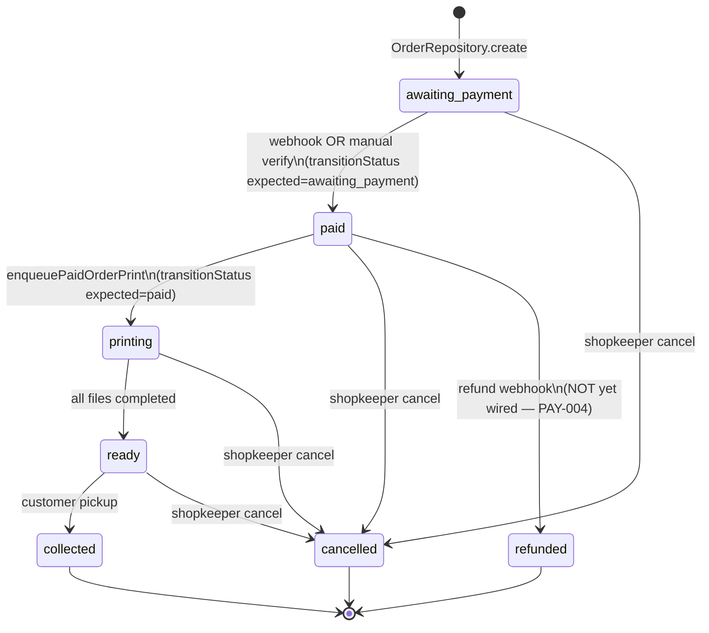
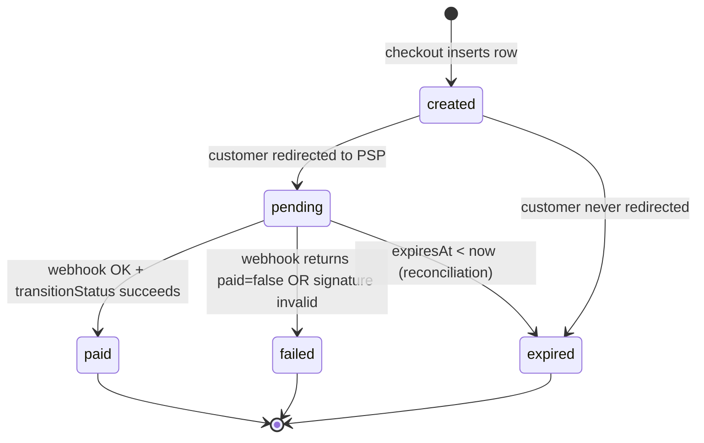

# Payment State Machine

> Canonical specification of the order / PaymentAttempt / PaymentEvent state
> machines for the PrintShop SaaS payment pipeline. Every state and transition
> in this document is sourced from:
> - `packages/core/src/domain/order.ts` — `ALLOWED_ORDER_TRANSITIONS` table
> - `packages/core/src/domain/enums.ts` — `OrderStatus` union
> - `prisma/schema.prisma` — `PaymentAttempt.status`, `PaymentEvent.eventType`
> - `src/lib/repositories/order.repository.ts` — `transitionStatus` race-safe guard
> - `src/lib/payments/webhook.service.ts` — `canTransitionOrder` precheck
> - `src/app/api/v1/shops/me/orders/[id]/verify-payment/route.ts`

## 1. Order State Machine

### 1.1 States

| State | Meaning | Set by |
|-------|---------|--------|
| `awaiting_payment` | Initial state. Order created; customer has not paid. Files may be uploaded + priced. | `OrderRepository.create` — default (`schema.prisma:79`, `order.repository.ts:117`) |
| `paid` | Payment captured (verified by webhook or shopkeeper). Print jobs eligible for enqueue. | `transitionStatus(..., 'awaiting_payment', {status:'paid', paidAt, paymentTxnId, paymentUtr, paymentProvider})` |
| `printing` | Print jobs enqueued; at least one file dispatched to a PrintAgent. | `transitionStatus(..., 'paid', {status:'printing'})` from `enqueuePaidOrderPrint` |
| `ready` | All files printed; awaiting customer pickup. | Shopkeeper route `/shops/me/orders/:id/ready` |
| `collected` | Customer has picked up the order. Terminal. | Shopkeeper route `/shops/me/orders/:id/complete` |
| `cancelled` | Order voided before payment completed (or before printing). Terminal. | `awaiting_payment → cancelled` (shopkeeper cancel route) |
| `refunded` | Payment was captured then refunded. Terminal. | `paid → refunded` (per transition table; no automated path yet — see §4) |

### 1.2 Permitted transitions

Source of truth: `ALLOWED_ORDER_TRANSITIONS` in `packages/core/src/domain/order.ts:53-61`.



### 1.3 Forbidden transitions (enforced)

| From | To | Why forbidden |
|------|----|---------------|
| `paid` | `awaiting_payment` | A captured payment cannot be "un-captured". A failed post-payment step requires `cancelled` or `refunded`, not a backward slide. |
| `printing` | `paid` | Cannot undo print dispatch. |
| `printing` | `awaiting_payment` | Same. |
| `ready` | `paid` / `printing` / `awaiting_payment` | Cannot rewind past `printing`. |
| `collected` | any | Terminal — `ALLOWED_ORDER_TRANSITIONS.collected === []`. |
| `cancelled` | any | Terminal — `ALLOWED_ORDER_TRANSITIONS.cancelled === []`. |
| `refunded` | any | Terminal — `ALLOWED_ORDER_TRANSITIONS.refunded === []`. |
| `awaiting_payment` | `printing` / `ready` / `collected` / `refunded` | Payment is a hard gate; you cannot skip `paid`. |
| `paid` | `ready` | Must pass through `printing`. |

### 1.4 What prevents invalid transitions

Three layered guards, checked in this order at runtime:

**Guard 1 — domain check (`canTransitionOrder`)** — fast fail in application code.
```ts
// webhook.service.ts:237
if (!canTransitionOrder(order.status, 'paid')) {
  return { statusCode: 200, summary: `order already in status '${order.status}' (idempotent)`, applied: false };
}
```
Same pattern in `verify-payment/route.ts:57` and `enqueuePaidOrderPrint` (implicit
via `transitionStatus`).

**Guard 2 — conditional UPDATE (`transitionStatus`)** — atomic DB-level enforcement.
```ts
// order.repository.ts:284-295
async transitionStatus(id, shopId, expectedCurrentStatus, patch) {
  const [updated] = await this.updateWhere(
    { id, shopId, status: expectedCurrentStatus },   // WHERE precondition
    patch,
  );
  return updated ? toDomain(updated) : null;         // null = 0 rows matched
}
```
The `WHERE status = expectedCurrentStatus` is the atomic guard against the
read-modify-write race: even if two concurrent requests both pass
`canTransitionOrder`, only one UPDATE matches the row's actual current status.
The loser gets `null` and returns idempotently without double-writing audit
logs or overwriting `paymentTxnId`.

**Guard 3 — `paymentTxnId @unique`** — replay guard at the column level.
```prisma
// schema.prisma:83
paymentTxnId String? @unique
```
A second transition attempting to set the same `paymentTxnId` (e.g. a replayed
webhook with the same PSP txn id) throws a UNIQUE constraint violation. Caught
by `isUniqueConstraintError` and treated as idempotent-skip:
```ts
// webhook.service.ts:277-286
catch (err) {
  if (isUniqueConstraintError(err)) {
    return { statusCode: 200, summary: 'payment_txn_id already applied (idempotent)', applied: false };
  }
  throw err;
}
```

For the manual verify path, the txnId is deterministic (`manual-<orderId>`,
`verify-payment/route.ts:66`) so the UNIQUE constraint is a real replay guard
rather than a per-call random UUID.

## 2. PaymentAttempt State Machine

> ⚠️ **Schema-defined but NOT wired.** As of Phase 5, no code writes a
> `PaymentAttempt` row (see PHASE_5_PAYMENT_ARCHITECTURE_AUDIT.md PAY-001).
> The transitions below are the **intended** lifecycle — implement when wiring
> the persistence layer.

### 2.1 States

Source: `prisma/schema.prisma:206` — `status String @default("created")` with
comment `created|pending|paid|failed|expired`.

| State | Meaning | Intended trigger |
|-------|---------|------------------|
| `created` | Attempt row inserted at checkout. merchantOrderId assigned. PSP payment intent created. | Checkout route, after `adapter.createPaymentIntent` returns |
| `pending` | Customer redirected to PSP page; awaiting payment confirmation. | Checkout response sent to customer |
| `paid` | Webhook or status API confirmed capture. `providerTransactionId` set. | `processWebhook` after `transitionStatus` succeeds |
| `failed` | PSP returned a failure callback or status API returned `paid:false`. | `processWebhook` when `v.paid === false`; PAYMENT_FAILED_EVENTS handler in `phonepe-v2-webhook.ts:181` |
| `expired` | `expiresAt` passed (10 min, `phonepe.adapter.ts:190`) without confirmation. | Reconciliation job (not yet implemented) |

### 2.2 Permitted transitions (intended)



### 2.3 What should prevent invalid transitions (when wired)

- `created → paid` directly is invalid — payment must pass through `pending`
  (the PSP capture flow). Enforce by conditional UPDATE:
  `UPDATE paymentAttempt SET status='paid' WHERE id AND status IN ('pending', 'created')`.
- `paid → pending` is invalid — a captured payment cannot return to pending.
- `failed → paid` is invalid — a failed attempt requires a new attempt row
  (new merchantOrderId). This is why the customer re-checks-out: a fresh
  `merchantOrderId` is generated and a new PaymentAttempt row is created.

### 2.4 Current gap

The schema declares the column and default, but `processWebhook` flips only
the `Order.status` — it never touches `PaymentAttempt.status`. A query like
`SELECT count(*) FROM payment_attempt WHERE shop_id=$1 AND status='paid'`
returns 0 for every shop. (PAY-001, PAY-005.)

## 3. PaymentEvent Lifecycle

### 3.1 Event types

Source: `prisma/schema.prisma:227` — `eventType String // webhook|status_check|reconciliation`.

| EventType | Source | Intended semantics |
|-----------|--------|--------------------|
| `webhook` | Inbound PSP callback (PhonePe X-VERIFY, PhonePe v2 SHA+JSON, Paytm CHECKSUMHASH) | The PSP's authoritative event stream. One row per inbound webhook payload. |
| `status_check` | Outbound poll of the PSP status API (`adapter.verifyPayment`) | Defense-in-depth: confirm the webhook's claim. Triggered by the UPI verify poller or a reconciliation job. |
| `reconciliation` | End-of-day reconciliation job comparing PaymentAttempt.status against PSP status API | Detects drift: webhook missed, status API mismatch, refund not applied. |

### 3.2 Processing status

Source: `prisma/schema.prisma:229` — `processingStatus String @default("received") // received|processed|skipped|failed`.

| ProcessingStatus | Meaning |
|------------------|---------|
| `received` | Row inserted; signature verification + business logic not yet run. |
| `processed` | Webhook applied — order transitioned (or idempotent skip). |
| `skipped` | Idempotent skip — `eventId` already seen (`@@unique([provider, eventId])`) or order already in target state. |
| `failed` | Signature verification failed OR amount mismatch OR tenant mismatch. Order NOT mutated. |

### 3.3 Idempotency guarantee (designed, NOT wired)

```prisma
// schema.prisma:235
@@unique([provider, eventId])
```

This constraint is the DB-level replay guard: PSPs retry webhooks (often 3+
times with the same `eventId`). The intended flow is:

1. Webhook arrives → `INSERT INTO payment_event (provider, event_id, ...)`.
2. If the INSERT throws P2002 (UNIQUE violation on `provider, eventId`),
   the event was already processed → return 200 idempotent-skip.
3. Otherwise proceed with signature verification + business logic, then
   `UPDATE payment_event SET processing_status='processed', processed_at=now()`.

⚠️ **As of Phase 5, no `paymentEvent.create` callsite exists** (PAY-002). The
constraint is therefore inert — replay protection relies on cache (L1) +
`Order.paymentTxnId` UNIQUE (L3) + conditional UPDATE (L2). See
`PHASE_5_PAYMENT_ARCHITECTURE_AUDIT.md` §7.

### 3.4 Audit-log vs PaymentEvent

The current pipeline writes `AuditLog` rows (not `PaymentEvent`):

- `webhook.${provider}.received` — before processing (`webhook.service.ts:127`)
- `webhook.${provider}.failed` — when `v.paid === false` (`webhook.service.ts:172`)
- `webhook.${provider}.paid` — after transition succeeds (`webhook.service.ts:293`)
- `webhook.phonepe-v2.paid` — v2 path (`phonepe-v2-webhook.ts:301`)
- `order.payment.verify` / `order.payment.reject` — manual path (`verify-payment/route.ts:89, 113`)

These are **application audit trails** (who/what/when), NOT idempotency
records. They do not dedupe — two replayed webhooks produce two `received`
rows. The `PaymentEvent` table is the right place for replay-safe dedup.

## 4. Refund transition (`paid → refunded`)

### 4.1 Current behaviour

The transition table permits `paid → refunded` (`order.ts:55`), but **no code
path executes it**:

- PhonePe adapter has a `refund()` method (`phonepe.adapter.ts:367-423`) that
  calls the PSP refund API and returns a `RefundResult`, but no route calls it.
- PhonePe v2 webhook receives `pg.refund.completed` / `pg.refund.failed`
  events and logs them, then returns 200 with `applied: false` and the
  comment "TODO: when PaymentEvent model is wired, persist this event"
  (`phonepe-v2-webhook.ts:161-173`).
- The order is NEVER transitioned to `refunded` automatically.

### 4.2 Intended flow

1. Shopkeeper initiates refund via (a yet-to-be-built) `/shops/me/orders/:id/refund` route.
2. Adapter `refund()` calls the PSP refund API.
3. PSP sends `pg.refund.completed` webhook → `processPhonePeV2Webhook` should:
   - Insert a `PaymentEvent(eventType='webhook', provider='phonepe', eventId=payload.eventId)`.
   - Insert a row in a (yet-to-be-built) `Refund` table or `Order.refundedAt` + `Order.refundTxnId` columns.
   - `transitionStatus(order.id, shop.id, 'paid', { status: 'refunded', refundedAt: new Date() })`.
4. Financial reports exclude the order's `totalAmountPaise` from revenue
   (see `FINANCIAL_METRIC_DEFINITIONS.md` §B — refund treatment).

### 4.3 Forbidden refund transitions

- `awaiting_payment → refunded` — nothing to refund.
- `printing → refunded`, `ready → refunded`, `collected → refunded` — refund
  is permitted only from `paid` per the transition table. A refund request on
  a `printing`/`ready` order should first transition to `cancelled`, then
  issue the PSP refund out-of-band.

## 5. State machine summary table

| From \ To | awaiting_payment | paid | printing | ready | collected | cancelled | refunded |
|-----------|------------------|------|----------|-------|-----------|-----------|----------|
| awaiting_payment | — | ✅ webhook/manual | ❌ | ❌ | ❌ | ✅ cancel | ❌ |
| paid | ❌ | — | ✅ enqueue | ❌ | ❌ | ✅ cancel | ✅ refund (not wired) |
| printing | ❌ | ❌ | — | ✅ done | ❌ | ✅ cancel | ❌ |
| ready | ❌ | ❌ | ❌ | — | ✅ pickup | ✅ cancel | ❌ |
| collected | ❌ | ❌ | ❌ | ❌ | — | ❌ | ❌ |
| cancelled | ❌ | ❌ | ❌ | ❌ | ❌ | — | ❌ |
| refunded | ❌ | ❌ | ❌ | ❌ | ❌ | ❌ | — |

✅ = permitted by `ALLOWED_ORDER_TRANSITIONS` and enforced by `transitionStatus`.
❌ = forbidden — `canTransitionOrder` returns false; `transitionStatus` returns null
(or the call site throws `ValidationError` before reaching the DB).

## 6. Testing the state machine

The race-safety properties are tested in:
- `src/lib/payments/payments.test.ts` — webhook idempotency
- `src/lib/payments/webhook-audit.test.ts` — audit-log behaviour
- `src/lib/payments/phonepe-v2-webhook.test.ts` — v2 SHA auth + event routing
- `src/lib/payments/print-job-idempotency.test.ts` — print enqueue dedup
- `src/lib/repositories/order-token-concurrency.test.ts` — order-token race
- `src/lib/token-consistency.test.ts` — token invariant

What is NOT tested (gaps):
- `paid → refunded` transition (no code path exists)
- `PaymentAttempt.status` advancement (no code path exists)
- `PaymentEvent` UNIQUE replay (no code path exists)
- Concurrent webhook + manual verify on the SAME order (the transitionStatus
  guard should make the loser return null — explicit test recommended)

— End of state machine spec. Source files cited inline.
