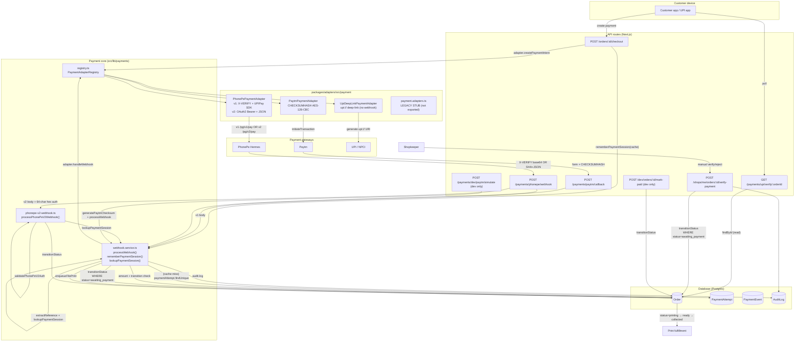
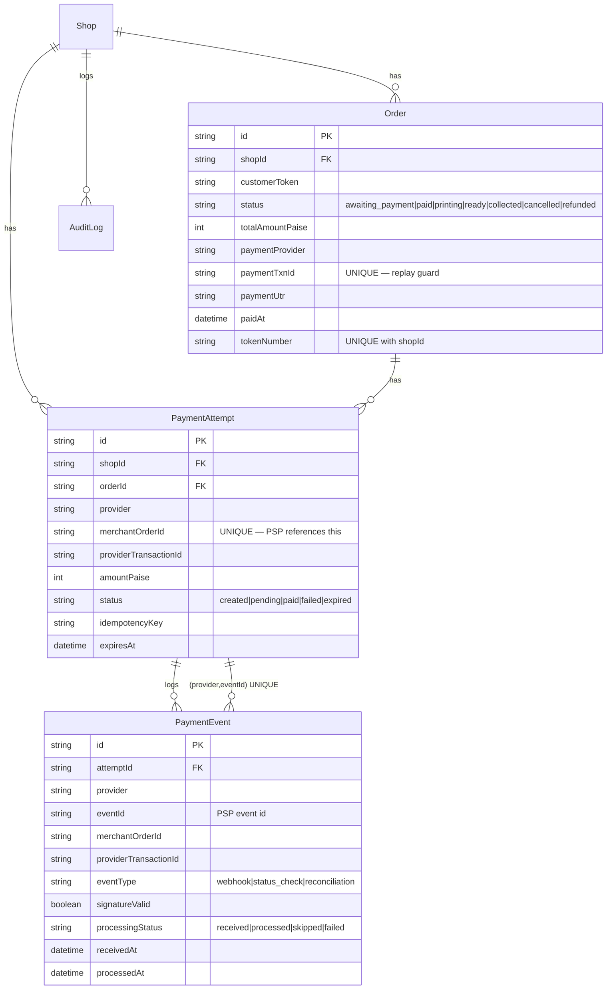

# Phase 5 Payment Architecture Audit

> Source-verified audit of the PrintShop SaaS payment pipeline. Every claim in
> this document was verified by reading the actual source file cited inline.
> Methodology: read every file under `src/lib/payments/`, every route under
> `src/app/api/v1/payments/` + `src/app/api/v1/orders/[id]/checkout/`, every
> adapter under `packages/adapters/src/payment/`, the `Order` /
> `PaymentAttempt` / `PaymentEvent` models in `prisma/schema.prisma`, and the
> `transitionStatus` race-safe helper.

## 1. Architecture Diagram

## 2. Route Inventory (7 routes)

| # | Method | Path | Auth | File | Purpose |
|---|--------|------|------|------|---------|
| 1 | POST | `/api/v1/orders/:id/checkout` | `withOrderAccess` (customerToken) + rate limit 20/min | `src/app/api/v1/orders/[id]/checkout/route.ts` | Create payment intent via shop's configured provider; remember merchantOrderId→order in cache |
| 2 | POST | `/api/v1/payments/phonepe/webhook` | None (PSP callback) | `src/app/api/v1/payments/phonepe/webhook/route.ts` | PhonePe callback. Detects v1 (X-VERIFY + base64) vs v2 (SHA hex + JSON with `event`) and dispatches to `processWebhook` or `processPhonePeV2Webhook` |
| 3 | POST | `/api/v1/payments/paytm/callback` | None (PSP callback) | `src/app/api/v1/payments/paytm/callback/route.ts` | Paytm callback. Form-urlencoded body + CHECKSUMHASH. Renders HTML page per spec |
| 4 | GET | `/api/v1/payments/upi/verify/:orderId` | Rate-limited 60/min, no auth | `src/app/api/v1/payments/upi/verify/[orderId]/route.ts` | DB-only status poll. Returns `paid=true` if order.status ∈ {paid, printing, ready, collected} |
| 5 | POST | `/api/v1/shops/me/orders/:id/verify-payment` | `withAuth(['owner'])` | `src/app/api/v1/shops/me/orders/[id]/verify-payment/route.ts` | Shopkeeper manual verify/reject. Deterministic txnId `manual-<orderId>`; conditional UPDATE |
| 6 | POST | `/api/v1/dev/orders/:id/mark-paid` | `requireDev` + rate limit 20/min | `src/app/api/v1/dev/orders/[id]/mark-paid/route.ts` | DEV: simulate a PSP webhook. Synthetic UTR; flips order to `paid` via direct status check |
| 7 | POST | `/api/v1/payments/dev/paytm/simulate` | `requireDev` | `src/app/api/v1/payments/dev/paytm/simulate/route.ts` | DEV: signs a Paytm callback with `generatePaytmChecksum` + feeds it through `processWebhook` end-to-end |

> Note: a sibling `/api/v1/payments/dev/phonepe/simulate` route also exists
> in the route tree but was not in this audit's reading list.

## 3. Provider Inventory

| Provider | Adapter class | Auth (create) | Webhook signature | Status API |
|----------|---------------|---------------|-------------------|------------|
| PhonePe v1 (Standard API) | `PhonePePaymentAdapter` (`provider: 'phonepe'`) | `merchantId + saltKey + saltIndex` via UPIPay SDK; X-VERIFY checksum `sha256(base64body + saltKey)###saltIndex` | UPIPay `verifyWebhook(rawBody, signature)` — real crypto | `client.checkStatus(merchantOrderId)` via UPIPay |
| PhonePe v2 (Business API) | `PhonePePaymentAdapter` (same class, auto-detect via `clientId + clientSecret`) | OAuth2 client_credentials → Bearer token; POST `/pg/v2/pay` | **Two distinct formats**: (a) v1-style X-VERIFY base64 body — `handleWebhook` decodes base64 directly and trusts `code === 'PAYMENT_SUCCESS'` if no saltKey; (b) v2-only `Authorization: SHA256(username:password)` hex + JSON `{event, payload}` — handled by separate `processPhonePeV2Webhook` | `verifyPayment`: GET `/pg/v2/status/{merchantId}/{merchantOrderId}` |
| Paytm | `PaytmPaymentAdapter` (`provider: 'paytm'`) | `merchantId + merchantKey + website` via UPIPay `createPayment` | `CHECKSUMHASH` = AES-128-CBC(sha256(params\|merchantKey)) — hand-rolled, IV `0123456789012345` | UPIPay `checkStatus(merchantOrderId)` POST `/v3/order/status` |
| UPI deep-link | `UpiDeepLinkPaymentAdapter` (`provider: 'googlepay'`) | None — generates `upi://pay?...` URI from shop's VPA | None — `handleWebhook` returns 404 | `verifyPayment` is a **stub** — always returns `{paid:false, txnId:null, amountPaise:null}`. Comment: "Phase 3" (still stub at Phase 5) |

Provider enum (`packages/core/src/domain/enums.ts`): `'phonepe' | 'paytm' | 'googlepay' | 'razorpay' | 'cashfree'`. Registry only registers the first three.

## 4. Database Model Relationships

`@@unique([provider, eventId])` on `PaymentEvent` is the DB-level replay guard
designed to dedupe PSP callbacks. `Order.paymentTxnId @unique` is the
authoritative "this payment was applied once" guard.

## 5. Confirmed Defects

| ID | Severity | Finding | Source evidence |
|----|----------|---------|-----------------|
| **PAY-001** | P0 | **`PaymentAttempt` is never written.** The checkout route calls only `rememberPaymentSession()` (cache set). No `paymentAttempts.create()` exists anywhere in the codebase. The DB fallback in `lookupPaymentSession` (lines 42–62 of `webhook.service.ts`) is therefore dead code unless a future path inserts the row. The Phase 4 "durable mapping" design is non-functional. | `checkout/route.ts:69` calls `rememberPaymentSession` only; `webhook.service.ts:42-62` queries a row nobody inserts |
| **PAY-002** | P0 | **`PaymentEvent` is never written.** Neither `processWebhook` nor `processPhonePeV2Webhook` inserts a row. The `@@unique([provider, eventId])` dedup constraint is bypassed — replay protection relies entirely on cache (10-min/24h) + `Order.paymentTxnId` UNIQUE. PSP events for refunds, failures, and status checks are not persisted. | No `paymentEvent.create` call anywhere; `webhook.service.ts` writes only to `auditLogs` |
| **PAY-003** | P0 | **PhonePe v2 webhook does NOT call `verifyPayment`** despite its header comment claiming it does. The status-API confirmation step ("server-side status confirmation") is documented at `phonepe-v2-webhook.ts:27` but absent from `processPaymentCompleted` (lines 204–343). The webhook trusts the JSON `payload.state` / `payload.amount` fields after only the SHA Authorization header check. | `phonepe-v2-webhook.ts:27` (comment) vs `:204-343` (code) — no `adapter.verifyPayment()` call |
| **PAY-004** | P1 | **Refund events are not persisted.** `processPhonePeV2Webhook` handles `pg.refund.completed` / `pg.refund.failed` by logging + returning 200 with `applied: false` and the explicit TODO "when PaymentEvent model is wired, persist this event." Refunds cannot be reconciled against orders. | `phonepe-v2-webhook.ts:161-173` |
| **PAY-005** | P1 | **`PaymentAttempt.status` is never advanced.** Schema defines `created|pending|paid|failed|expired`, but no code path mutates this column after creation (and per PAY-001 nothing creates it). Reconciliation queries against `PaymentAttempt.status` would return only `created`. | `schema.prisma:206`; no `paymentAttempt.update` call anywhere |
| **PAY-006** | P1 | **PhonePe adapter `handleWebhook` v2 fallback bypasses signature verification.** When v2 credentials are present (`clientId + clientSecret`) but no `saltKey`, the adapter decodes the base64 body directly and trusts `code === 'PAYMENT_SUCCESS' || state === 'COMPLETED'` from the payload. The header claims "the status API verification is the authoritative check" — but per PAY-003 that call is never made. Defense-in-depth gap. | `phonepe.adapter.ts:274-300` |
| **PAY-007** | P1 | **Manual verify hardcodes `paymentProvider: 'googlepay'`.** A shop with PhonePe configured whose shopkeeper uses the manual fallback will record `paymentProvider='googlepay'` on the order — corrupting provider-level analytics. | `verify-payment/route.ts:78` |
| **PAY-008** | P0 | **`grossPaidValuePaise` includes refunded orders.** `admin/analytics/route.ts:45` filter is `status !== 'cancelled' && status !== 'awaiting_payment'` — this ADMITS `refunded` orders into "paid value". `shopEarningsPaise = grossPaidValuePaise` propagates the error. `platformRevenuePaise = 0` is correct only under the (current) "no commission" model — it conflates with subscription revenue. | `admin/analytics/route.ts:45-46, 86-87` |
| **PAY-009** | P1 | **Daily report `verifiedCollections` does not subtract refunds** and `totalOrderValue` mixes awaiting/cancelled/paid orders. The `paidAt && paymentTxnId` test (line 50) is true for refunded orders too (paidAt is never cleared on refund), so refunded money is counted as collected. | `shops/me/reports/daily/route.ts:50` |
| **PAY-010** | P1 | **UPI deep-link adapter is still a Phase 3 stub at Phase 5.** `verifyPayment` returns `{paid:false,...}` unconditionally and `handleWebhook` returns 404. UPI confirmation depends entirely on the manual `verify-payment` route — no automated path exists for UPI orders. | `upi-deeplink.adapter.ts:66-86` |
| **PAY-011** | P2 | **PhonePe webhook route logs auth header prefix + body prefix to `console.log`.** `authHeader.slice(0, 8)` + `rawBody.slice(0, 20)` are written on every webhook — these may leak partial credentials / PII into Vercel logs. Should be `logger.debug` only with redaction. | `phonepe/webhook/route.ts:30-41` |
| **PAY-012** | P2 | **`extractReference` only handles `phonepe` and `paytm`.** A `razorpay` or `cashfree` provider (declared in the enum) would return `null` and the webhook would 400. Adding those providers requires extending this function. | `webhook.service.ts:72-90` |
| **PAY-013** | P2 | **`payment.adapters.ts` is a legacy stub.** It redefines `PhonePePaymentAdapter` and `UpiDeepLinkPaymentAdapter` with `throw 'not implemented until Phase 3'`. The package index (`packages/adapters/src/index.ts:16-18`) does NOT export it — so the dead class never wins the registry. Risk: if anyone adds `export * from './payment/payment.adapters'`, the stub silently shadows the real adapters. | `packages/adapters/src/payment/payment.adapters.ts:19-37`; `packages/adapters/src/index.ts:16-18` |
| **PAY-014** | P2 | **Paytm IV discrepancy.** The adapter uses IV `0123456789012345` for both `generatePaytmChecksum` (dev) and `verifyPaytmChecksum` (production). The header comment at `paytm.adapter.ts:208-216` notes the official Paytm algorithm uses a different IV (`@@@@&&&&####$$$$`). The hand-rolled version is internally consistent but **diverges from the official Paytm SDK** — production callbacks from real Paytm (signed with the official IV) would FAIL verification. | `paytm.adapter.ts:29, 208-216, 73-89` |
| **PAY-015** | P3 | **`processedKey` cache check is non-atomic with the `transitionStatus` UPDATE.** TOCTOU window between `cache.get` (line 192) and `cache.set` (line 292). Mitigated by `Order.paymentTxnId` UNIQUE + `isUniqueConstraintError` catch (lines 277–286) — the DB guard is authoritative. | `webhook.service.ts:192, 277-286, 292` |
| **PAY-016** | P3 | **`extractReference` for PhonePe decodes base64 BEFORE signature verification.** This is by design (you need the merchantOrderId to load credentials before you can verify) and is safe because the decoded value is only used as a lookup key — never trusted for state mutation. Documented for completeness. | `webhook.service.ts:72-90` |

## 6. Implementation Status Matrix

| Capability | Status | File |
|------------|--------|------|
| PhonePe v1 create + verify + refund (UPIPay SDK) | ✅ Implemented | `phonepe.adapter.ts:194-228, 245-272, 402-417` |
| PhonePe v2 OAuth2 + create + verify + refund | ✅ Implemented | `phonepe.adapter.ts:96-129, 157-191, 309-365, 374-401` |
| PhonePe v1 webhook X-VERIFY | ✅ Implemented (UPIPay `verifyWebhook`) | `phonepe.adapter.ts:245-272` |
| PhonePe v2 webhook SHA+JSON | ⚠️ Implemented but missing `verifyPayment` defense-in-depth (PAY-003) | `phonepe-v2-webhook.ts` |
| Paytm create + verify + refund (UPIPay SDK) | ✅ Implemented | `paytm.adapter.ts:146-201, 272-302, 307-338` |
| Paytm webhook CHECKSUMHASH | ⚠️ Implemented but IV diverges from official (PAY-014) | `paytm.adapter.ts:225-266` |
| UPI deep-link intent generation | ✅ Implemented | `upi-deeplink.adapter.ts:23-64` |
| UPI deep-link verify + webhook | ❌ Stub (Phase 3 never shipped, PAY-010) | `upi-deeplink.adapter.ts:66-86` |
| Amount validation (mandatory) | ✅ Implemented (Phase 4 fix) | `webhook.service.ts:217-236`; `phonepe-v2-webhook.ts:240-248` |
| Tenant mismatch guard | ✅ Implemented | `webhook.service.ts:208-211`; `phonepe-v2-webhook.ts:234-237` |
| Race-safe `transitionStatus` | ✅ Implemented (DB-004 fix) | `order.repository.ts:284-295` |
| Deterministic manual txnId | ✅ Implemented | `verify-payment/route.ts:66` |
| UPI checkout fallback (intent without checkoutUrl) | ✅ Implemented | `checkout/route.ts:54-65` |
| `PaymentAttempt` persistence | ❌ Never written (PAY-001) | n/a |
| `PaymentEvent` persistence | ❌ Never written (PAY-002) | n/a |
| `PaymentAttempt.status` advancement | ❌ Never updated (PAY-005) | n/a |
| Refund event persistence | ❌ TODO (PAY-004) | `phonepe-v2-webhook.ts:167` |
| Refund flow on Order (`paid → refunded`) | ✅ Allowed by transition table | `domain/order.ts:55` |
| Razorpay / Cashfree adapters | ❌ Not implemented (enum only) | `enums.ts:23-30` |

## 7. Idempotency Layers (defense in depth)

The pipeline has **three** idempotency layers; only two are currently effective.

| Layer | Mechanism | Effective? | Source |
|-------|-----------|------------|--------|
| L1 — Cache fast-path | `processedKey = pay:done:${provider}:${txnId ?? merchantOrderId}`; checked before the transitionStatus UPDATE; set with 24h TTL after success. Returns 200 idempotent-skip. | ✅ Yes (within cache TTL, on a single cache instance) | `webhook.service.ts:191-201, 292`; `phonepe-v2-webhook.ts:267-272, 298` |
| L2 — Conditional UPDATE | `repos.orders.transitionStatus(id, shopId, 'awaiting_payment', patch)` — UPDATE … WHERE id AND shopId AND status='awaiting_payment'. Returns `null` (0 rows matched) if a concurrent request already flipped the order. | ✅ Yes — authoritative for state | `order.repository.ts:284-295`; `webhook.service.ts:254-273`; `verify-payment/route.ts:71-88` |
| L3 — DB UNIQUE on `paymentTxnId` | `Order.paymentTxnId @unique` — a second INSERT/UPDATE with the same txnId throws P2002 / 23505. Caught by `isUniqueConstraintError` and treated as idempotent-skip. | ✅ Yes — authoritative for replay (when txnId is present) | `schema.prisma:83`; `webhook.service.ts:277-286`; `phonepe-v2-webhook.ts:290-295` |
| L4 (designed, NOT wired) — `PaymentEvent@@unique([provider, eventId])` | Designed to dedupe by the PSP's own event id. Schema declares the constraint. | ❌ Bypassed (PAY-002) — no row is ever written. | `schema.prisma:235` |
| L5 (designed, NOT wired) — `PaymentAttempt.merchantOrderId @unique` | Designed to be the durable merchantOrderId→order map when cache expires. | ❌ Bypassed (PAY-001) — no row is ever written. | `schema.prisma:202`; `webhook.service.ts:42-62` queries a row that does not exist |

**Manual verify race-safety:** the txnId is deterministic (`manual-<orderId>`)
so two concurrent manual verifies produce the SAME txnId — the UNIQUE
constraint catches the duplicate. (ARCH-001 fix; `verify-payment/route.ts:66`.)

**Webhook + manual verify race:** both call `transitionStatus` with
`expectedCurrentStatus='awaiting_payment'`. Only one UPDATE matches; the
loser gets `null` and returns idempotently without double-audit-logging.

## 8. What is implemented vs stub vs unverified

**Implemented and source-verified:**
- PhonePe v1 + v2 create/verify/refund (with caveats PAY-003, PAY-006)
- Paytm create/verify/refund (with caveat PAY-014)
- Webhook signature verification for PhonePe v1 (UPIPay), PhonePe v2 SHA, Paytm AES-CBC
- Amount-mandatory validation, tenant-mismatch guard, race-safe transitions
- Manual verify-payment with deterministic txnId
- UPI checkout fallback deep-link generation

**Stub (declared, never wired):**
- `UpiDeepLinkPaymentAdapter.verifyPayment` returns hardcoded `paid:false`
- `UpiDeepLinkPaymentAdapter.handleWebhook` returns hardcoded 404
- `UpiDeepLinkPaymentAdapter.refund` returns hardcoded `failed`
- `payment.adapters.ts` legacy stub class — not exported, but defines
  `throw 'not implemented until Phase 3'` methods (PAY-013)

**Unverified (declared in schema, no code writes to them):**
- `PaymentAttempt` rows (PAY-001) — schema + migration exist; no insert callsite
- `PaymentEvent` rows (PAY-002) — schema + UNIQUE constraint exist; no insert callsite
- `PaymentAttempt.status` transitions (PAY-005) — column exists; never updated
- Razorpay / Cashfree adapters — enum entries only

## 9. Next Actions

1. **PAY-001 / PAY-002 (P0):** Insert a `PaymentAttempt` row in the checkout
   route (status `created`); insert a `PaymentEvent` row at the top of
   `processWebhook` / `processPhonePeV2Webhook` (eventType `webhook`).
   Advance `PaymentAttempt.status` to `paid` / `failed` after the transition.
   This unlocks L4 + L5 of the idempotency stack.
2. **PAY-003 (P0):** Call `adapter.verifyPayment({merchantOrderId, shopCredentials})`
   in `processPaymentCompleted` before `transitionStatus`. Reject if the
   status API returns `paid:false` or `amountPaise` mismatch.
3. **PAY-008 / PAY-009 (P0):** Fix `grossPaidValuePaise` to exclude `refunded`.
   Fix `verifiedCollections` to subtract refunded amount. Define a separate
   `subscriptionRevenuePaise` sourced from the `Subscription` table — see
   `FINANCIAL_METRIC_DEFINITIONS.md`.
4. **PAY-004 (P1):** Persist refund events. Consider transitioning the order
   `paid → refunded` automatically when a refund webhook arrives (currently
   refund callbacks are logged + dropped).
5. **PAY-006 (P1):** For v2 callbacks without `saltKey`, require the status
   API call. Reject the webhook if `verifyPayment` fails.
6. **PAY-007 (P1):** Use the shop's `paymentProvider` (or `'manual'`) on the
   manual verify path instead of hardcoding `'googlepay'`.
7. **PAY-010 (P1):** Wire the UPI deep-link `verifyPayment` to a PSP status
   API (e.g. PhonePe `/pg/v2/status` if the shop has PhonePe creds) or accept
   that UPI requires manual verify and document it as a product limit.
8. **PAY-011 (P2):** Replace `console.log` redaction leaks with `logger.debug`
   + redaction.
9. **PAY-013 (P2):** Delete `payment.adapters.ts` (legacy stub) to remove the
   shadow risk.
10. **PAY-014 (P2):** Switch Paytm verification to UPIPay's `verifyWebhook`
    (official IV) and update the dev simulate route to sign with the same.

— End of audit. Source files read: 15. Findings: 16 (3× P0, 5× P1, 4× P2, 2× P3).
